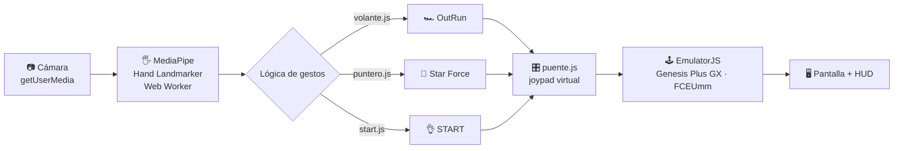

<div align="center">

# ✋ Control por gestos

### OutRun y Star Force, jugados con la mano frente a la cámara

<br>

<a href="https://villariasthiago.github.io/control-por-gestos/">
  
</a>

<br><br>

🔗 **[villariasthiago.github.io/control-por-gestos](https://villariasthiago.github.io/control-por-gestos/)**

**👆 Hacé click, permití la cámara y jugá, sin instalar nada 👆**

<br>


</div>

---

## 🚀 Cómo empezar (1 minuto)

| | Paso | |
|:-:|---|---|
| 1️⃣ | Abrí el [**sitio**](https://villariasthiago.github.io/control-por-gestos/) en **Chrome** o **Edge** | 🌐 |
| 2️⃣ | Elegí el archivo de la **ROM** de cada juego (una sola vez, queda guardada en tu navegador) | 💾 |
| 3️⃣ | Tocá **▶ Jugar** y permití el uso de la **cámara** | 📷 |
| 4️⃣ | Poné la mano a unos **50 cm** de la cámara, con buena luz de frente | ✋ |

> [!IMPORTANT]
> **Este repositorio no incluye ni distribuye ROMs.** Cada jugador usa su propia copia. La ROM se guarda solo en tu navegador (IndexedDB) y nunca se sube a ningún servidor.

| Juego | Sistema | Extensiones aceptadas |
|---|---|---|
| 🏎️ OutRun | Mega Drive / Genesis | `.md` `.bin` `.gen` `.smd` `.zip` |
| 🚀 Star Force | NES | `.nes` `.zip` |

---

## 🎮 Los gestos

### 🏎️ OutRun · volante virtual

| Gesto | Qué hace |
|---|---|
| 🛞 **Inclinar la mano** (muñeca) | Gira el auto a izquierda o derecha. Hay una zona muerta alrededor de -90° para que el rumbo sea suave |
| ✋ **Palma abierta** | Acelera, y se mantiene aunque rotes la mano |
| ✊ **Puño cerrado** | Cambia de marcha |

### 🚀 Star Force · puntero con el dedo

| Gesto | Qué hace |
|---|---|
| ☝️ **Dedo índice** | Mueve la nave. En el cuadro central el movimiento es fino para esquivar; en el perímetro es continuo y a máxima velocidad |
| 🔫 **Autofire doble** | Dispara solo, alternando dos botones para la mayor cadencia |
| 🔄 **Modo inercia** | Si la cámara pierde la mano por un movimiento brusco, la nave conserva velocidad y disparo |

### 👌 En cualquier juego

**Gesto OK sostenido durante 0,8 s = START.** Sirve para pasar los menús sin tocar el teclado.

---

## 🧠 Cómo funciona



1. **Captura.** El navegador abre la cámara con `getUserMedia`. El video se procesa en tu equipo y no se envía a ningún lado.
2. **Detección.** [MediaPipe Hand Landmarker](https://github.com/google-ai-edge/mediapipe) corre en un Web Worker y devuelve 21 puntos de la mano por fotograma. Usa la GPU y, si no se puede, cae a CPU. Al estar en un worker, no le roba frames ni audio al emulador.
3. **Interpretación.** Funciones puras, con tests, convierten los puntos en intención de juego: ángulo de la palma para el volante, relación de distancias dedos/muñeca para distinguir puño de palma, posición del índice para el puntero.
4. **Entrada.** `puente.js` traduce los gestos a botones de un joypad libretro y los inyecta en EmulatorJS con `simulateInput`. No usa el teclado del sistema, así que no hay problemas de foco.
5. **Juego y HUD.** El emulador ejecuta tu ROM y un canvas transparente muestra dirección, marcha, radar y vista de cámara encima, sin interceptar clics.

### 🔬 Qué cambió respecto de la versión de escritorio

| Escritorio (Python) | Web | Ventaja |
|---|---|---|
| OpenCV `VideoCapture` | `getUserMedia` | Sin drivers ni backends por sistema operativo |
| MediaPipe Python | MediaPipe Tasks (WASM) en un Worker | No compite con el emulador por recursos |
| pynput (teclado del SO) | `simulateInput` de EmulatorJS | Sin teclas ignoradas por RetroArch ni problemas de foco |
| `time.sleep` en el cambio de marcha | `setTimeout` | No congela la detección |
| HUD PyQt5 click-through | Canvas con `pointer-events: none` | Mismo resultado sin hacks por sistema |
| Conflicto Qt/xcb entre OpenCV y PyQt5 | No existe | — |

### 🗂️ Estructura del código

```
index.html / js/menu.js      Menú, carga y validación de ROMs (cabecera iNES / firma SEGA)
juego.html / js/juego.js     Orquestador
js/manos.js                  Cámara + MediaPipe Hand Landmarker
js/detector.worker.js        MediaPipe en un Web Worker (GPU, con fallback a CPU)
js/gestos/volante.js         Lógica OutRun (función pura, testeada)
js/gestos/puntero.js         Lógica Star Force + modo inercia (función pura, testeada)
js/gestos/start.js           Gesto OK → START
js/puente.js                 Gestos → joypad libretro de EmulatorJS
js/hud.js                    HUD de OutRun, radar de Star Force y vista de cámara
js/config.js                 Todos los umbrales de calibración
```

---

## 🎚️ Calibración

Todos los umbrales viven en `js/config.js`:

| Parámetro | Valor | Para qué sirve |
|---|---|---|
| `anguloIzq` / `anguloDer` | -110° / -70° | Rango de giro del volante |
| `ratioPunio` / `ratioPalma` | 1.25 / 1.45 | Cuándo se considera puño o palma |
| `pulsoMarchaMs` | 100 ms | Duración del pulso de cambio de marcha |
| `zonaX` / `zonaY` | 75 / 60 px | Zona de precisión del puntero |
| `umbralDelta` | 4 px | Movimiento mínimo (normalizado por tiempo) |
| `cadenciaMs` | 60 ms | Velocidad del autofire |

Para probar sin cámara, abrí `juego.html?juego=outrun&debug` y usá `window.__gestos` desde la consola.

---

## 🛠️ Para desarrolladores

```bash
bash scripts/vendor.sh        # una vez: baja dependencias a vendor/ (requiere node/npm y curl)
python3 -m http.server 8000   # http://localhost:8000 (localhost también habilita la cámara)
npm test                      # tests de la lógica de gestos
```

Sin `vendor.sh`, el sitio igual funciona cargando todo desde los CDN oficiales.

**Deploy:** cada push a `main` dispara el workflow de GitHub Actions, que verifica que no haya ROMs en el repo (por firma binaria, aunque el archivo se llame `.md`), corre los tests, descarga EmulatorJS, los cores, MediaPipe y el modelo de manos, y publica en GitHub Pages. Requiere **Settings → Pages → Source: GitHub Actions**. GitHub Pages sirve por HTTPS, que es lo que exige el navegador para usar la cámara.

---

## 🙌 Créditos

- [EmulatorJS](https://github.com/EmulatorJS/EmulatorJS) (GPL-3.0) con los cores Genesis Plus GX y FCEUmm.
- [MediaPipe](https://github.com/google-ai-edge/mediapipe) (Apache-2.0), Hand Landmarker.
- Proyecto presentado en la jornada de puertas abiertas de la facultad.
- OutRun © SEGA. Star Force © Tecmo / Hudson Soft. Este proyecto no está afiliado a esas empresas.
